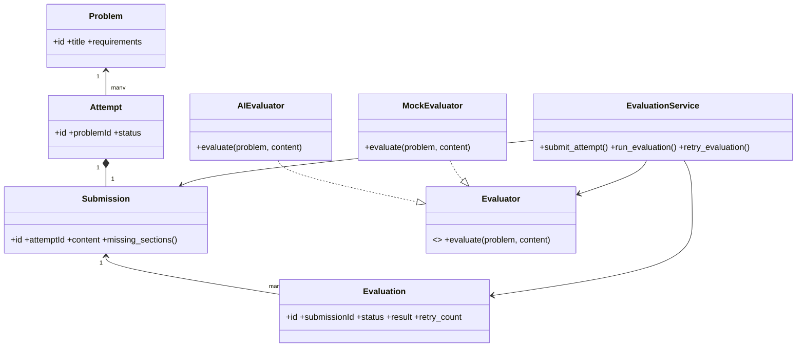

# DESIGN.md

## MVP Summary

A React + FastAPI monolith where a learner browses 5 curated LLD problems,
writes a structured-text design against one, submits it, and receives
AI-generated, evidence-cited, rubric-based feedback via a non-blocking
background evaluation. Failed evaluations can be retried without losing
the submission. Every attempt is retained so a learner can see how their
designs improve across retries.

## Learner Journey

```text
Landing (Problem List) → Problem Detail → Start Attempt →
Design/Submission (autosaved) → Submit → Evaluating (polled) →
Feedback → Attempt History → Retry ("Try Again" -> new Attempt)
```

## Domain Model

| Class | Responsibility | Depends on |
|---|---|---|
| `Problem` | Static reference data for one LLD problem | — |
| `Attempt` | Owns lifecycle state for one learner's try at one `Problem` | `Problem` |
| `Submission` | The learner's design content; deterministic completeness check | `Attempt` |
| `Evaluator` (interface) | Contract: `evaluate(problem, submission_content) -> result dict` | — |
| `AIEvaluator` | Concrete strategy — calls the Anthropic API with the fixed rubric | `Evaluator`, `Rubric` |
| `MockEvaluator` | Concrete strategy — deterministic stand-in used when no API key is set | `Evaluator` |
| `Rubric` (`RUBRIC_CRITERIA`) | The fixed set of AI-evaluated criteria | — |
| `Evaluation` | Record of one evaluation run; owns PENDING/COMPLETED/FAILED status | `Submission` |
| `EvaluationService` | Orchestrates the full submit -> evaluate -> retry flow; the only place that knows the whole sequence | everything above |



## Evaluation Approach

Two layers, deliberately split:

1. **Deterministic (runs first, free, instant):** `Submission.missing_sections()`
   checks that all four required sections are non-empty. If not, the API
   returns 400 with the exact missing sections — the AI is never called
   on an incomplete submission.
2. **AI (7 subjective criteria):** requirement understanding, class
   responsibilities, coupling/cohesion, encapsulation, interface/
   abstraction usage, extensibility, explanation quality. Each is scored
   with evidence quoted from the submission, a `classification`
   (issue / improvement / tradeoff / preference), a concern, a
   suggestion, and a confidence score.

The `classification` field is the direct answer to "how do you handle
multiple valid LLD solutions" — the model is instructed to only mark
something an "issue" if it violates a stated requirement or principle,
not merely for differing from a common solution.

## Key Trade-offs

- **Text over code/diagram submissions** — text captures *reasoning*
  ("why this design"), which is what's actually being evaluated; code
  and diagrams show only "what," and diagrams would have consumed a
  disproportionate share of the 2-day budget on editor tooling alone.
- **Deterministic-vs-AI split** — structure/completeness is cheap and
  unambiguous, so it's deterministic; design-quality judgment is
  irreducibly subjective, so it's AI, with a fixed rubric to keep it
  consistent.
- **`BackgroundTasks` over a task queue** — non-blocking evaluation was
  a stated requirement, but a real queue (Celery/RabbitMQ) is
  distributed-systems scope the assignment explicitly excludes.
  `BackgroundTasks` gets the same non-blocking behavior at this scale.
- **SQLite over Postgres** — zero setup overhead; sufficient for a
  single-user local prototype; swappable later via `DATABASE_URL` alone
  since access goes through SQLAlchemy.
- **Monolith over services** — one deployable, one repo; nothing in this
  scope needs independent scaling or deployment.

## Change Test A — adding a diagram submission format later

Only `Submission.content_type` and `content` shape change (a new
`content_type="diagram"` with a different payload schema), plus the
frontend gains a diagram editor page. `Attempt`, `Evaluator`,
`Evaluation`, and `EvaluationService` are untouched — `Evaluator.evaluate()`
already takes `submission_content` as an opaque dict, so a diagram
payload flows through the same seam a text payload does today. The
`AIEvaluator` prompt-builder would need a diagram-aware variant, but
that's additive (a new method or a second `Evaluator` implementation),
not a rewrite.

## Change Test B — adding a second evaluator later

Implement `Evaluator` once more (e.g. `RuleBasedEvaluator` or
`HumanReviewEvaluator`), register it in `get_default_evaluator()` (or a
future selection mechanism keyed by evaluator type), and nothing else
changes. `EvaluationService.submit_attempt()` and `run_evaluation()`
already call `get_default_evaluator()` and treat the return value
purely through the `Evaluator` interface — they have no knowledge of
which concrete evaluator is running. This is exactly what `MockEvaluator`
already demonstrates in this MVP: it's a second, real, working
`Evaluator` implementation, swapped in automatically with zero changes
to the service or API layer.

## What was deliberately NOT built

- A generic `Repository<T>` abstraction — a thin, direct SQLAlchemy
  session per service method was enough at this scale; a generic
  repository would have been speculative generality with no second
  implementation to justify it.
- A full State-pattern class hierarchy for `Attempt`/`Evaluation`
  status — 4–5 linear states with a handful of guard checks in
  `EvaluationService` don't need per-state classes.
- A separate `Feedback` class distinct from `Evaluation.result` — the
  structured JSON result already serves as the feedback payload; adding
  a wrapper class would have added indirection without a distinct
  responsibility to justify it.
- Real auth, admin problem-authoring UI, diagram/code submission
  formats, multiple simultaneous evaluators — all explicitly out of
  scope for the 2-day MVP (see the "Do Not Build" list in the plan).
